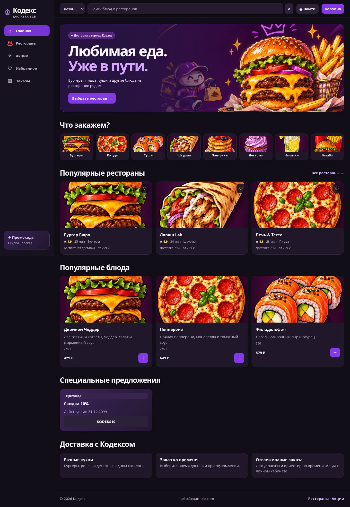

# Кодекс — доставка еды

Русскоязычный сервис доставки с каталогом ресторанов, корзиной, оформлением и отслеживанием заказов, личным кабинетом и защищённой админ-панелью. В поставку входят иллюстрации, исходники, миграции и тестовый каталог для Казани, Самары и Москвы.



[Мобильная версия](docs/screenshots/home-mobile.png) · [Оформление заказа](docs/screenshots/checkout.png)

## Локальный запуск

Требуются Node.js 24 и npm.

```sh
npm ci
cp .env.example .env
npm start
```

Откройте http://127.0.0.1:3000. SQLite-файл создаётся при первом запуске. Зарегистрируйте покупателя в интерфейсе. Промокод для проверки скидки — `KODEKS10`.

Для первого администратора задайте `ADMIN_EMAIL` и `ADMIN_PASSWORD` в `.env` до запуска. Минимальная длина пароля — 10 символов, для размещённого экземпляра используйте уникальный длинный пароль. Администратор создаётся только для свободного адреса. Уже зарегистрированный аккаунт сохраняет свою роль и пароль. После создания уберите установочные переменные из окружения и перезапустите приложение. Вход находится в шапке, а ссылка на админ-панель — в личном кабинете.

## Что можно проверить

- Поиск блюд и ресторанов, сортировку, фильтры и избранное по городам.
- Меню, количество, добавки, промокоды, минимальную сумму и расчёт доставки. При заказе из нескольких ресторанов доставка суммируется.
- Гостевую корзину в браузере и перенос её содержимого в аккаунт после входа.
- Выбор сохранённого адреса, время доставки, демо-оплату и наличные.
- Статусы заказа, состав, ориентировочное время, историю и сохранённые адреса.
- Управление ресторанами, блюдами, изображениями, промокодами, пользователями, статусами и настройками в админ-панели. Изображения можно загрузить в PNG, JPEG или WebP до 550 КБ либо указать HTTPS-адрес.

## Архитектура

| Путь | Назначение |
| --- | --- |
| `public/` | Адаптивный интерфейс, клиентская навигация, стили и иллюстрации |
| `server.mjs` | Express, аутентификация, расчёт заказа, API |
| `db/` | Версионированные миграции SQLite, выполняемые при старте |
| `test/` | Интеграционные тесты API и сквозной сценарий Chromium |
| `scripts/build.mjs` | Проверка синтаксиса и подготовка `dist/` |

Клиент и API обслуживаются с одного origin. Пароли обрабатываются scrypt с индивидуальной солью. Сессии используют HttpOnly SameSite cookie, токены хранятся в БД в хешированном виде. Ввод проверяется Zod, API использует параметризованные запросы. Роли и принадлежность заказа проверяются на сервере. Расчёт скидки, запись заказа и очистка корзины выполняются в одной транзакции. Повтор запроса с тем же ключом возвращает уже созданный заказ.

| Маршрут | Назначение |
| --- | --- |
| `GET /api/catalog` | Витрина, список городов и актуальные предложения |
| `POST /api/register`, `/api/login`, `/api/logout` | Сессия |
| `GET /api/me`, `PATCH /api/me` | Профиль, корзина, избранное, адреса |
| `POST /api/quote` | Проверка состава и серверный расчёт |
| `POST /api/orders`, `GET /api/orders`, `GET /api/orders/:id` | Создание и просмотр своих заказов |
| `GET /api/admin/data` | Управление и статистика |
| `PUT /api/admin/{restaurants,dishes,promos}/{new,key}`, `DELETE /api/admin/:entity/:key` | Управление каталогом и промокодами |
| `PATCH /api/admin/orders/:id`, `PATCH /api/admin/users/:id`, `PUT /api/admin/settings` | Статусы, роли и настройки |

Суммы в API задаются целыми рублями. Клиент страницы отслеживания обновляет заказ каждые 15 секунд. Для карты потребуется отдельный аутентифицированный источник координат и контроль доступа на уровне заказа. Демо-оплата сохраняет выбор клиента без списания. Для реальной оплаты требуется интеграция провайдера и обработка подтверждённых вебхуков. Статус наличного заказа оператор меняет вручную.

## Сборка и проверка

```sh
npm run build
npm test
BROWSER_BIN=/usr/bin/chromium SCREENSHOTS=1 npm test
```

Сквозной сценарий выполняется при наличии `BROWSER_BIN`. Скриншоты обновляются при `SCREENSHOTS=1`. Тесты работают на базе в памяти с вымышленными данными.

## Развёртывание

Сборка содержит сервер и статические файлы. Запуск на хостинге требует постоянно работающего Node-процесса и диска для SQLite. GitHub хранит исходники. Для исполнения API используйте Node-хостинг или контейнер.

```sh
npm ci
npm run build
cd dist
npm ci --omit=dev
cp .env.example .env
npm start
```

Для контейнера в `.env` установите `HOST=0.0.0.0`, `DB_PATH=/app/data/kodeks.sqlite`, `PORT=3000`.

```sh
docker build -t kodeks-food .
docker volume create kodeks-data
docker run -d --name kodeks --env-file .env \
  -p 127.0.0.1:3000:3000 -v kodeks-data:/app/data kodeks-food
```

Разместите HTTPS-прокси перед процессом, задайте `PUBLIC_ORIGIN` как точный адрес сайта без завершающего слеша и `TRUST_PROXY=1` при одном доверенном прокси. `DB_PATH` должен указывать на каталог, доступный для записи процессу. Для резервной копии используйте SQLite backup API или снимок согласованного тома. Для начального развёртывания запустите один экземпляр приложения. Контакты и тестовый каталог заменяются через админ-панель.

## Публикация исходников

Краткое описание репозитория: «Кодекс — сервис доставки еды с каталогом, заказами и админ-панелью». Темы: `food-delivery`, `nodejs`, `sqlite`.

После входа в GitHub CLI создайте репозиторий из корня проекта:

```sh
gh repo create kodeks-food --public --source=. --remote=origin --push \
  --description "Кодекс — сервис доставки еды с каталогом, заказами и админ-панелью"
```
